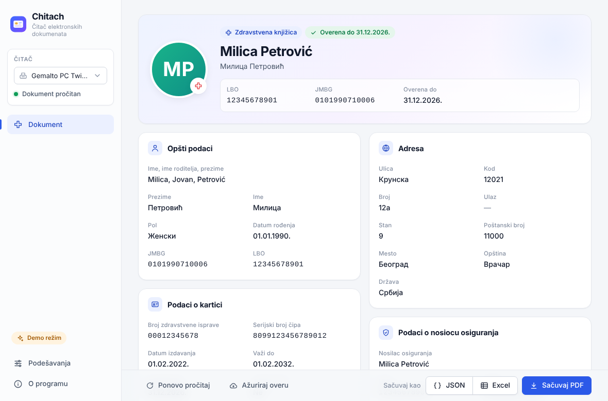
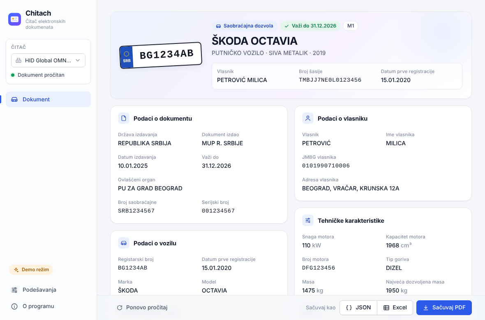
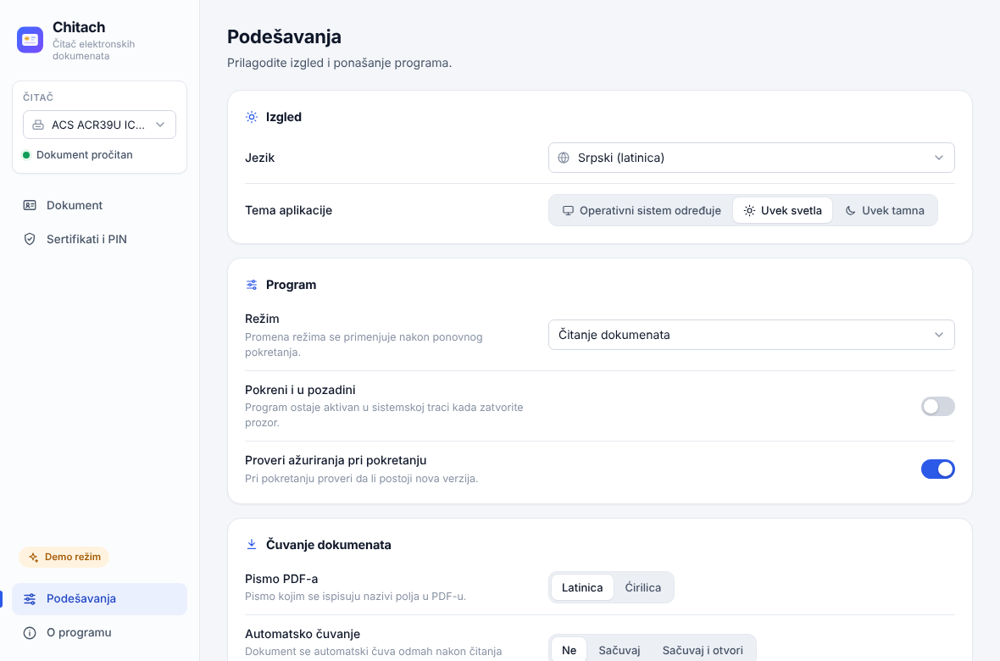

<p align="center">
  
</p>

<h1 align="center">Chitach</h1>

<p align="center">
  Reader for Serbian smart-card documents — ID card, health insurance card, vehicle registration<br>
  for <b>Windows</b>, <b>macOS</b> and <b>Linux</b>
</p>

<p align="center">
  <a href="https://github.com/vahidzekic/Chitach/releases/latest"></a>
  <a href="https://github.com/vahidzekic/Chitach/actions/workflows/ci.yml"></a>
  <a href="LICENSE"></a>
</p>

<p align="center"><a href="https://vahidzekic.github.io/Chitach/">Website (Serbian)</a> · <a href="README.md">Srpski</a></p>

---

**Chitach** is a free, open-source desktop application that reads documents issued by the
Republic of Serbia on smart cards, with a new, modern interface. It is written in Rust
(Tauri v2).

## Features

* **ID card** (lična karta) — all chip models (Gemalto and Apollo): personal data, address,
  photo, document data
* **Health insurance card** (zdravstvena knjižica) — insured person and insurance data;
  the **"valid until"** date is fetched from the RFZO web service with one click
* **Vehicle registration card** (saobraćajna dozvola) — vehicle, owner and user data
* Export to **PDF** (same layout as the official form, Latin or Cyrillic labels),
  **JSON** and **XLSX**
* Automatic reader and card detection, optional **auto-save** of a PDF on every read
* Change the ID card **PIN**, view and save the **certificates**
* **Smartbox** emulation for logging in to **ePorezi** and **XML signing** (PKCS#11)
* Light and dark theme; Serbian (Latin and Cyrillic), English and Russian UI
* System tray (run in background), update check
* **`chitach-cli`** command-line tool
* Your data stays on your computer (apart from the RFZO query you trigger yourself)

## Download

Latest version: **[github.com/vahidzekic/Chitach/releases/latest](https://github.com/vahidzekic/Chitach/releases/latest)**

| OS | File |
|---|---|
| **Windows 10/11** (x64) | `Chitach_X.Y.Z_x64-setup.exe` (or `.msi`) |
| **macOS 10.15+** (Intel and Apple Silicon) | `Chitach_X.Y.Z_universal.dmg` |
| **Ubuntu / Debian / Mint** (x64 / arm64) | `Chitach_X.Y.Z_amd64.deb` / `Chitach_X.Y.Z_arm64.deb` |
| **Fedora / RHEL / openSUSE** (x64 / arm64) | `Chitach-X.Y.Z-1.x86_64.rpm` / `Chitach-X.Y.Z-1.aarch64.rpm` |
| **Other Linux** (x64 / arm64) | `Chitach_X.Y.Z_amd64.AppImage` / `Chitach_X.Y.Z_aarch64.AppImage` |
| **Command line** | `chitach-cli-windows-x64.exe`, `chitach-cli-macos-universal`, `chitach-cli-linux-x64`, `chitach-cli-linux-arm64` |

> **macOS:** the app is not notarized — the first time, right-click it → *Open*, or click
> *Open Anyway* in *System Settings → Privacy & Security*.
> **Linux:** the `pcscd` service is required: `sudo systemctl enable --now pcscd`.
> **Windows:** if SmartScreen warns you, click *More info → Run anyway*.

The detailed user guide (in Serbian) is in [docs/05-korisnicko-uputstvo.md](docs/05-korisnicko-uputstvo.md).

## Screenshots

| ID card | Health insurance card |
|---|---|
|  |  |
| **Vehicle registration** | **Waiting for a card** |
|  |  |
| **Settings** | **Dark theme** |
|  |  |

*Screenshots show made-up sample data.*

## Command line

```sh
chitach-cli --list                    # list readers
chitach-cli --pdf id.pdf              # save PDF
chitach-cli --json data.json          # save JSON
chitach-cli --help                    # all options
```

## Building from source

You need Rust (stable), Node.js 22 and the system libraries for Tauri and PC/SC
(on Linux `libwebkit2gtk-4.1-dev`, `libpcsclite-dev`, … — see [docs/06-razvoj.md](docs/06-razvoj.md)).

```sh
git clone https://github.com/vahidzekic/Chitach.git
cd Chitach
npm --prefix ui ci
npm --prefix ui exec -- tauri dev       # development (CHITACH_MOCK=1 to run without a reader)
npm --prefix ui exec -- tauri build     # installers for the current OS
cargo build --release -p chitach-cli    # CLI
```

Releases are built by GitHub Actions when a `vX.Y.Z` tag is pushed.

## Documentation (Serbian)

* [User guide](docs/05-korisnicko-uputstvo.md)
* [Development, building and releasing](docs/06-razvoj.md)
* [Architecture](docs/02-arhitektura.md)
* [API contract (Rust ↔ UI)](docs/04-api-ugovor.md)
* [Implementation plan](docs/03-plan-implementacije.md)
* [Technology research](docs/01-istrazivanje-jezika.md)
* [Contributing](CONTRIBUTING.md)

## Code signing policy

Free code signing for Windows releases is provided by [SignPath.io](https://about.signpath.io/),
with a certificate by [SignPath Foundation](https://signpath.org/).

* Committers and reviewers: [repository owner](https://github.com/vahidzekic)
* Approvers: [vahidzekic](https://github.com/vahidzekic)

Only files built by GitHub Actions from this repository for a published tag are signed.

**Privacy:** card data never leaves the computer unless specifically requested by the user
(the RFZO query, the fines check after explicit consent). On start-up the program checks GitHub
for a new version; this can be turned off in the settings.

## License

Author: **Vahid Zekic** ([github.com/vahidzekic](https://github.com/vahidzekic)).
Chitach is released under the [MIT License](LICENSE).

* **Liberation Sans** fonts — SIL Open Font License 1.1 ([assets/fonts/LICENSE-OFL.txt](assets/fonts/LICENSE-OFL.txt)).
* Third-party licenses: [THIRD_PARTY_LICENSES.md](THIRD_PARTY_LICENSES.md).

Chitach is not an official application of the Ministry of Interior,
RFZO or any other government institution.
