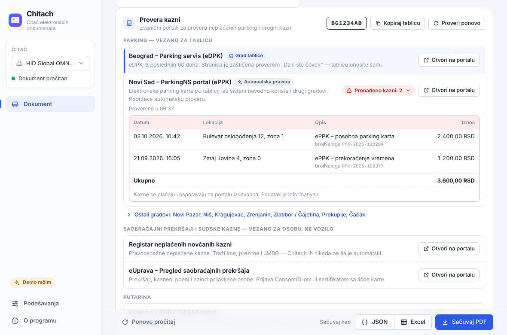

# Korisničko uputstvo

Chitach čita srpske elektronske dokumente sa pametnih kartica:

* **ličnu kartu** (sa čipom, svi modeli — Gemalto i Apollo),
* **zdravstvenu knjižicu** (zdravstvena kartica RFZO),
* **saobraćajnu dozvolu**,

prikazuje podatke i fotografiju, i čuva ih kao **PDF** (izgled kao u zvaničnim
aplikacijama), **JSON** ili **XLSX** (Excel). Potreban je bilo koji PC/SC čitač pametnih
kartica (Gemalto, Hama, Samtec, ACS, Identiv…).

## 1. Instalacija

Sve instalacije se nalaze na stranici
**[github.com/vahidzekic/Chitach/releases/latest](https://github.com/vahidzekic/Chitach/releases/latest)**.

| Sistem | Fajl |
|---|---|
| Windows 10/11 (64-bit) | `Chitach_X.Y.Z_x64-setup.exe` (preporučeno) ili `Chitach_X.Y.Z_x64_en-US.msi` |
| macOS 10.15 ili noviji (Intel i Apple Silicon) | `Chitach_X.Y.Z_universal.dmg` |
| Ubuntu, Debian, Linux Mint (x64 / arm64) | `Chitach_X.Y.Z_amd64.deb` / `Chitach_X.Y.Z_arm64.deb` |
| Fedora, RHEL, openSUSE (x64 / arm64) | `Chitach-X.Y.Z-1.x86_64.rpm` / `Chitach-X.Y.Z-1.aarch64.rpm` |
| Ostale Linux distribucije | `Chitach_X.Y.Z_amd64.AppImage` / `Chitach_X.Y.Z_aarch64.AppImage` |

### Windows

1. Preuzmite `…_x64-setup.exe` i pokrenite ga.
2. Ako se pojavi plavi prozor **"Windows protected your PC"** (SmartScreen), kliknite
   **More info → Run anyway**. Upozorenje se javlja jer instalacija nije potpisana
   komercijalnim sertifikatom.
3. Instaler pita da li se program instalira samo za vas ili za sve korisnike (za drugu opciju
   su potrebna administratorska prava). Ako na računaru nema Microsoft Edge WebView2
   komponente (stariji Windows 10), instaler je automatski preuzima.

Windows sadrži PC/SC podršku i drajvere za većinu čitača — nije potrebno ništa dodatno.
MSI paket je namenjen administratorima koji instaliraju program preko grupnih polisa.

### macOS

1. Preuzmite `…_universal.dmg`, otvorite ga i prevucite **Chitach** u **Applications**.
2. Aplikacija nije notarizovana kod Apple-a, pa će je macOS prvi put blokirati
   ("Chitach can't be opened because Apple cannot check it for malicious software"
   ili "…is damaged"):
   * kliknite **Done/OK**, zatim otvorite **System Settings → Privacy & Security**,
     pri dnu pronađite poruku o aplikaciji Chitach i kliknite **Open Anyway**, potvrdite
     lozinkom i kliknite **Open**; **ili**
   * u Finder-u desni klik (Control-klik) na Chitach → **Open** → **Open**.
3. Ako i dalje piše da je aplikacija oštećena, u Terminalu izvršite:
   ```sh
   xattr -dr com.apple.quarantine /Applications/Chitach.app
   ```

macOS sadrži PC/SC podršku (CryptoTokenKit) — drajveri za čitače nisu potrebni.

### Linux

Na Linuksu je za pristup čitaču potreban servis **pcscd** i drajver **CCID**.

**Debian / Ubuntu / Mint**
```sh
sudo apt install ./Chitach_X.Y.Z_amd64.deb      # povlači libpcsclite1 i pcscd
sudo apt install libccid                        # drajver za većinu USB čitača
sudo systemctl enable --now pcscd
```

**Fedora / RHEL**
```sh
sudo dnf install ./Chitach-X.Y.Z-1.x86_64.rpm   # povlači pcsc-lite i pcsc-lite-ccid
sudo systemctl enable --now pcscd
```

**openSUSE**: `sudo zypper install ./Chitach-X.Y.Z-1.x86_64.rpm pcsc-ccid`, zatim
`sudo systemctl enable --now pcscd`.

**AppImage** (bilo koja distribucija): instalirajte `pcsc-lite`/`pcscd` i `ccid` iz
paketa vaše distribucije, uključite servis, pa:
```sh
chmod +x Chitach_X.Y.Z_amd64.AppImage
./Chitach_X.Y.Z_amd64.AppImage
```
(Na novijim distribucijama AppImage može zahtevati paket `libfuse2` / `fuse2`.)

Proverite da sistem vidi čitač: `pcsc_scan` (paket `pcsc-tools`).

## 2. Upotreba

1. Priključite čitač i pokrenite Chitach. Na početnom ekranu piše
   **"Ubacite karticu"** (ili **"Nema čitača"** ako čitač nije pronađen).
2. Ubacite karticu (čipom nagore/ka čitaču). Čitanje traje nekoliko sekundi —
   lična karta oko 3–5 s zbog fotografije.
3. Prikazuju se podaci grupisani po celinama (lični podaci, prebivalište, podaci o dokumentu,
   vozilo, osiguranje…), sa fotografijom kod lične karte. Vrednost polja možete kopirati
   klikom na nju.
4. Dugmad u gornjem delu:
   * **PDF / JSON / XLSX** — čuvanje dokumenta; podrazumevano ime fajla je ime i prezime
     (npr. `petar_petrovic.pdf`).
   * **Ažuriraj** (zdravstvena knjižica) — preuzima datum **"overena do"** sa RFZO servisa.
     Ovaj podatak se ne upisuje na karticu pri overi, pa ga i zvanična RFZO aplikacija
     preuzima preko interneta. Šalju se samo LBO i broj kartice.
   * **PIN** (lična karta) — promena PIN-a za kvalifikovani elektronski sertifikat.
     Prikazuje se broj preostalih pokušaja; posle 3 pogrešna unosa PIN se blokira i
     odblokira se samo u policijskoj upravi (PUK).
   * **Sertifikati** (lična karta) — pregled i čuvanje sertifikata sa kartice (`.cer`).
5. Ako je priključeno više čitača, izaberite čitač u listi čitača; podrazumevano se koristi
   prvi čitač u kome je kartica.
6. Kada izvadite karticu, prikaz se vraća na početni ekran.

### Provera kazni (saobraćajna dozvola)

Ispod podataka saobraćajne dozvole nalazi se panel **Provera kazni** sa zvaničnim portalima
na kojima se proveravaju neplaćene kazne:

* **Parking** (vezano za tablicu) — parking servisi Beograda, Novog Sada, Novog Pazara, Niša,
  Kragujevca, Zrenjanina, Zlatibora, Prokuplja i Čačka. Portal grada iz tablice (npr. `BG`)
  je na vrhu i označen sa **Grad tablice**; ostali gradovi su pod **Ostali gradovi**.
* **Saobraćajni prekršaji i sudske kazne** (vezano za osobu, ne vozilo) — Registar
  neplaćenih novčanih kazni i eUprava „Pregled saobraćajnih prekršaja" (prijava ConsentID-om
  ili sertifikatom sa lične karte).
* **Putarina** — ENP / Toll4All nalog (javna provera po tablici ne postoji).

**Otvori na portalu** otvara stranicu u pregledaču; ako portal ne prima tablicu u adresi,
Chitach je istovremeno kopira u clipboard da biste je nalepili u polje. **Kopiraj tablicu**
kopira tablicu u obliku koji portali očekuju (velika slova, bez razmaka i crtica, ćirilica
prevedena u latinicu, npr. `BG 123-AB` → `BG123AB`).

**Automatska provera** (opciono) postoji samo za portale koji to tehnički dozvoljavaju —
trenutno **ParkingNS** (Novi Sad). Klikom na **Proveri automatski** prvi put se prikazuje
dijalog saglasnosti sa nazivom domena kome se šalje tablica (**Dozvoli** / **Otkaži**).
Rezultat se prikazuje uz portal: **Nema kazni**, **Pronađeno kazni: N** (klik prikazuje
datum, lokaciju, opis i iznos), **Proveri ručno** (portal je odbio automatski upit ili
traži proveru „da li ste čovek"), **Nedostupno** ili **Neočekivan odgovor**. Kazne se
plaćaju i osporavaju na portalu izdavaoca.

Privatnost:

* šalje se **samo registarska oznaka**, direktno zvaničnom portalu (bez posrednika), jednim
  zahtevom po proveri; rezultat se čuva samo u memoriji 30 minuta i nikad se ne upisuje na disk;
* ime, prezime i JMBG vlasnika se **nikada** ne šalju automatski;
* saglasnost se može opozvati u **Podešavanja → Provera kazni**; tu se uključuje i
  **Automatski proveri pri čitanju** i biraju portali za automatsku proveru;
* ako aplikaciju koristite u poslovne svrhe (npr. agencija za registraciju), vi ste rukovalac
  podacima u smislu Zakona o zaštiti podataka o ličnosti.



## 3. Podešavanja

Otvaraju se ikonicom zupčanika.

| Podešavanje | Opis |
|---|---|
| **Jezik** | Srpski (latinica), Српски (ћирилица), English, Русский |
| **Tema** | Sistemska, svetla, tamna |
| **Pismo labela u PDF-u** | Latinične ili ćirilične labele u PDF-u lične karte |
| **Automatsko čuvanje** | Isključeno / Sačuvaj PDF / Sačuvaj i otvori PDF pri svakom čitanju kartice |
| **Folder za automatsko čuvanje** | Postojeći folder u koji se snimaju PDF-ovi (mora biti izabran) |
| **Radi u pozadini** | Zatvaranje prozora sakriva aplikaciju u sistemsku traku (tray) umesto izlaska |
| **Proveri nove verzije** | Pri pokretanju proverava GitHub da li postoji novija verzija |
| **Mod rada** | **Čitač** (podrazumevano), **Smartbox** (prijava na ePorezi) ili **Potpisivanje XML-a** |
| **Provera kazni** | Automatska provera pri čitanju saobraćajne dozvole, saglasnost za slanje tablice (opoziv) i izbor portala za automatsku proveru |
| **PKCS#11 moduli** | Putanje do PKCS#11 biblioteka izdavalaca (MUP, PKS, Pošta, Halcom, E-Smart); prazno = podrazumevana lokacija |

Promena moda rada važi posle ponovnog pokretanja aplikacije. Podešavanja se čuvaju u
`settings.json`:

* Linux: `~/.config/rs.chitach.desktop/settings.json`
* macOS: `~/Library/Application Support/rs.chitach.desktop/settings.json`
* Windows: `%APPDATA%\rs.chitach.desktop\settings.json`

### Smartbox (ePorezi)

U modu **Smartbox** Chitach emulira aplikaciju Smartbox koju koristi portal
[ePorezi](https://eporezi.purs.gov.rs/user/login.html) za prijavu kvalifikovanim
sertifikatom. Potrebno je da imate instaliran PKCS#11 modul za vašu karticu (za ličnu
kartu — MUP-ov modul ili `srb-id-pkcs11`) i da je putanja do njega podešena ako nije na
podrazumevanoj lokaciji. Dok je mod aktivan, Chitach mora biti pokrenut; prijava se
radi iz pretraživača kao i sa zvaničnim Smartbox-om.

### Potpisivanje XML-a

U modu **Potpisivanje XML-a** izaberite izdavaoca i slot, unesite PIN, izaberite sertifikat
i XML fajl — Chitach pravi potpisanu kopiju (XML-DSig).

## 4. Komandna linija (`chitach-cli`)

Za skripte i servere postoji program bez grafičkog interfejsa. Preuzmite
`chitach-cli-<os>-<arch>` sa stranice izdanja (na Linuksu/macOS-u:
`chmod +x chitach-cli-*`; na macOS-u eventualno `xattr -d com.apple.quarantine chitach-cli-macos-universal`).

Primeri (tačan spisak opcija daje `chitach-cli --help`):

```sh
chitach-cli --list                          # spisak čitača
chitach-cli --atr                           # ATR kartice
chitach-cli --pdf licna.pdf                 # PDF
chitach-cli --json podaci.json --excel podaci.xlsx
chitach-cli --pdf licna.pdf --cyrillic-labels
chitach-cli --rfzo-valid-until --json knjizica.json   # zdravstvena + "overena do" sa RFZO
chitach-cli --reader 1 --pdf dokument.pdf   # čitač po indeksu iz --list
chitach-cli --verbose --pdf dokument.pdf    # dodatni detalji u terminalu
chitach-cli --version
```

Ako je priključeno više čitača, čitač se bira opcijom `--reader <indeks>` (indeks iz `--list`).

## 5. Rešavanje problema

| Problem | Rešenje |
|---|---|
| **"Nema čitača"** | Proverite USB kabl i probajte drugi port. Linux: `sudo systemctl enable --now pcscd`, instalirajte `libccid` / `pcsc-lite-ccid`, proverite sa `pcsc_scan`. Windows: u Device Manager-u čitač treba da bude pod *Smart card readers*. |
| Čitač vidljiv, ali kartica se ne čita | Izvadite i ponovo ubacite karticu, okrenite je (čip ka kontaktima). Zatvorite druge programe koji koriste karticu (zvanični Čelik, Smartbox, pretraživač sa otvorenim ePorezima). |
| **"Nepoznata kartica"** | Kartica nije lična karta, zdravstvena ili saobraćajna (npr. bankovna kartica) ili je model koji još nije podržan. Prijavite problem sa ATR-om (prikazan na ekranu ili `chitach-cli --atr`). |
| Linux: `pcscd` radi, ali nema pristupa | Na nekim sistemima (polkit) obični korisnik nema dozvolu — proverite `journalctl -u pcscd` i pravila u `/usr/share/polkit-1/actions/org.debian.pcsc-lite.policy`. Restart: `sudo systemctl restart pcscd`. |
| Linux: prazan/beo prozor | Probajte `WEBKIT_DISABLE_DMABUF_RENDERER=1 chitach` (problem sa nekim GPU drajverima). |
| macOS: "aplikacija je oštećena" | `xattr -dr com.apple.quarantine /Applications/Chitach.app` |
| Windows: aplikacija se ne pokreće | Instalirajte [Microsoft Edge WebView2 Runtime](https://developer.microsoft.com/microsoft-edge/webview2/). |
| RFZO "Ažuriraj" ne radi | Potrebna je internet veza; RFZO servis je povremeno nedostupan — pokušajte kasnije. |
| PIN blokiran | Posle 3 pogrešna PIN-a sertifikat se može odblokirati samo u policijskoj upravi. |
| Automatsko čuvanje ne radi | U podešavanjima izaberite postojeći folder za automatsko čuvanje. |

Greške i predloge prijavite na
[github.com/vahidzekic/Chitach/issues](https://github.com/vahidzekic/Chitach/issues)
(navedite OS, model čitača i ATR kartice — **ne šaljite lične podatke sa kartice**).
